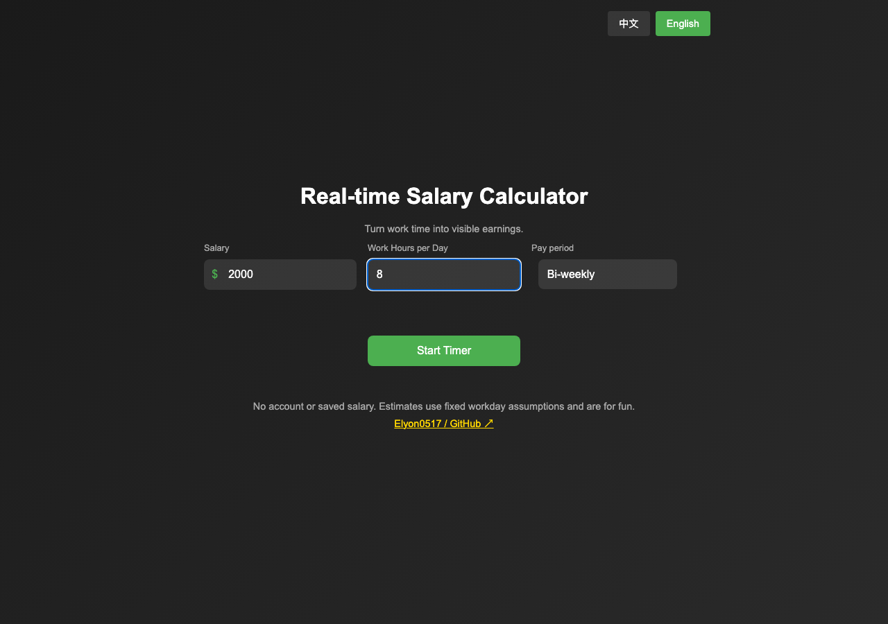

# Work Slacking Timer

**Turn work time into visible earnings.**

Enter your salary and daily work hours, then watch an estimated earnings counter grow.
A small browser tool with no account, app installation or runtime dependencies.

[**Try it online →**](https://elyon0517.github.io/Work-Slacking-Timer/) · [简体中文](README.zh-CN.md)

**Enjoy the timer? [Give it a star ⭐](https://github.com/Elyon0517/Work-Slacking-Timer) — it helps more people discover the project.**


*Actual browser capture with example inputs and a fixed test rate of 7.2 CNY/USD. The counter shows estimates, not a payroll record.*

## Features

- Biweekly, monthly and yearly salary inputs; click the currency symbol to switch CNY / USD.
- Elapsed earnings, active time and estimated earnings per second, hour and day.
- Pause/resume excludes paused time. Cancel resets the session; reaching the daily limit stops it.
- Chinese and English UI, including the timer controls; desktop and mobile layouts.
- Reference exchange rates with an explicitly labeled fallback.
- No salary history or browser storage. Reloading clears the inputs and timer.

## Try it

1. Open the [online timer](https://elyon0517.github.io/Work-Slacking-Timer/) and select **English** in the top-right corner.
2. Choose a pay period and currency, enter your salary and daily work hours.
3. Start, pause or resume the counter. Cancel returns to the input screen.

For example, a biweekly salary of USD 2,000 divided by 10 workdays and 8 hours/day gives
USD 25/hour. After 3 active hours, the estimate is USD 75. Paused time is excluded.

<details>
<summary>See the English setup and mobile screens</summary>




</details>

## Calculation assumptions

| Pay period | Estimated daily income |
|---|---|
| Biweekly | Salary / 10 workdays |
| Monthly | Salary / 21 workdays |
| Yearly | Salary / 260 workdays |

Hourly income is daily income divided by your entered daily hours. Earnings use active
elapsed time, excluding pauses. Currency conversion uses the same reference rate in both
directions. Taxes, holidays, bonuses and overtime are not modeled.

## Privacy and network access

Salary and time are calculated in the current page and are not uploaded or saved to browser
storage. The page fetches USD reference rates from `api.exchangerate-api.com`; this request
contains no salary or work-hours input. A failed request keeps a valid reference rate, using
7.2 CNY/USD initially if needed. The fallback is labeled on screen.

There is no offline installation, reload recovery or history dashboard in this version.

## Run locally

Python 3 is sufficient; Node is not required to run the app:

```bash
git clone https://github.com/Elyon0517/Work-Slacking-Timer.git
cd Work-Slacking-Timer
python3 -m http.server 8000
```

Open [localhost:8000](http://localhost:8000). The site can be hosted by any static web server.

## Browser tests and screenshots

With Node 24 and npm:

```bash
npm ci
npx playwright install chromium
npm run test:e2e
```

See [capture and validation details](docs/SHOWCASE.md). Screenshots use example salaries,
a fixed exchange-rate fixture and the browser's virtual clock; the real UI calculates all values.

If this makes your workday a little more fun, a [star](https://github.com/Elyon0517/Work-Slacking-Timer/stargazers)
helps others find it. [Issues and ideas](https://github.com/Elyon0517/Work-Slacking-Timer/issues) are welcome.

## License and attribution

Original project: [Elyon0517 / Work-Slacking-Timer](https://github.com/Elyon0517/Work-Slacking-Timer).
[MIT License](LICENSE); retain applicable copyright and permission notices when redistributing
copies or substantial portions. A repository link is appreciated, not an extra license condition.
See [COPYRIGHT.md](COPYRIGHT.md) and [CITATION.cff](CITATION.cff).
