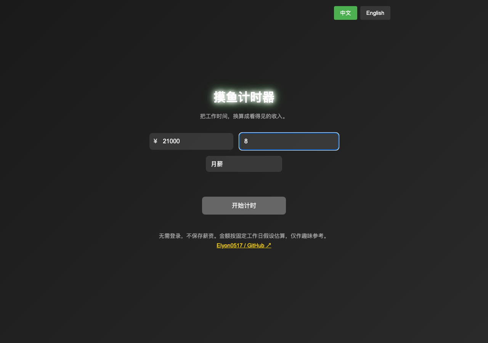
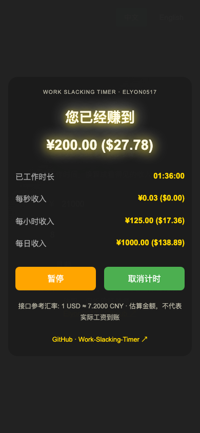

<div align="center">

# 摸鱼计时器 · Work Slacking Timer

**让工作时间，变成看得见的收入。**

输入薪资和每天工作时长，看收入估算随计时增长。一个无需登录、无需安装的浏览器小工具。

[**立即体验 →**](https://elyon0517.github.io/Work-Slacking-Timer/) · [English](README.md) · [本地运行](#本地运行) · [测试与截图](docs/SHOWCASE.md)

[](LICENSE)

</div>


*真实浏览器截图，使用示例月薪 ¥21,000、每天 8 小时、计时 1 小时 36 分钟；截图汇率固定为 1 USD = 7.2 CNY。金额为换算估算，不是实际工资到账记录。*

## 可以做什么

- **看着收入增长。** 同时展示已计时收入、工作时长，以及每秒、每小时和每日收入估算。
- **按自己的薪资周期输入。** 支持两周薪、月薪、年薪；点击薪资框左侧的 `¥ / $` 切换输入币种。
- **暂停，再继续。** 暂停期间不累计时间和收入；取消后可重新开始，到达设定的每日工作时长会自动停止。
- **人民币 / 美元对照。** 获取接口参考汇率；接口不可用时使用备用汇率，并在页面上标明。
- **中文 / English。** 桌面和手机都可使用。
- **轻量、无账号。** 纯 HTML / CSS / JavaScript，无应用运行依赖，不保存薪资或计时记录。

## 30 秒试一下

1. 打开 [在线页面](https://elyon0517.github.io/Work-Slacking-Timer/)。
2. 例如输入月薪 `21000`、每日工作 `8` 小时，选择「月薪」。
3. 点击「开始计时」，查看持续增长的估算收入。
4. 使用「暂停 / 继续」控制计时；「取消计时」返回输入页面。

<details>
<summary>查看输入页面、手机端和英文界面</summary>






</details>

## 金额怎么算

先把输入薪资换算成每日收入，再根据你输入的每日工时计算时薪和秒薪。

| 输入周期 | 每日收入估算 |
|---|---|
| 两周薪 | 输入金额 ÷ 10 个工作日 |
| 月薪 | 输入金额 ÷ 21 个工作日 |
| 年薪 | 输入金额 ÷ 260 个工作日 |

```text
每小时收入 = 每日收入 ÷ 每日工作小时数
已计时收入 = 每小时收入 × 实际累计计时小时数
```

暂停时间不计入累计时长。跨币种金额使用同一参考汇率换算；显示金额保留两位小数，计算使用未取整值。
这些是固定工作日假设，未计算税费、奖金、假期或加班，不适合作为工资单或结算依据。

## 隐私与网络请求

薪资和计时在当前页面内计算，不会上传到薪资服务，也不会写入浏览器存储；刷新或关闭页面后重置。
页面会向 `api.exchangerate-api.com` 发出获取 USD 参考汇率的请求，**请求不包含输入的薪资和工时**。
联网请求正常工作时使用接口数值，否则保留有效参考值；首次无法获取时使用 `7.2 CNY / USD`，页面会标明备用汇率。

## 本地运行

只需要 Python 3，不需要 Node 或安装前端依赖：

```bash
git clone https://github.com/Elyon0517/Work-Slacking-Timer.git
cd Work-Slacking-Timer
python3 -m http.server 8000
```

打开 [http://localhost:8000](http://localhost:8000)。这是静态页面，部署到 GitHub Pages 或其他静态托管即可。
当前版本不提供离线安装、跨刷新恢复或历史统计。

## 开发与浏览器验证

Node 24 和 npm 仅用于开发测试；应用本身不依赖它们。

```bash
npm ci
npx playwright install chromium
npm run test:e2e
```

测试覆盖三种薪资周期、人民币 / 美元换算、暂停恢复、输入校验、结束重启、汇率异常和手机布局，
并自动生成 README 中的截图。完整范围见 [SHOWCASE.md](docs/SHOWCASE.md)。

如果这个小工具让你的工作日多一点乐趣，欢迎 [Star](https://github.com/Elyon0517/Work-Slacking-Timer/stargazers)，
也欢迎通过 [Issue](https://github.com/Elyon0517/Work-Slacking-Timer/issues) 提交问题或想法。

## 来源、版权与署名

原始项目：[Elyon0517 / Work-Slacking-Timer](https://github.com/Elyon0517/Work-Slacking-Timer)。
采用 [MIT License](LICENSE)，分发副本或实质部分时须保留适用的版权与许可声明。
文章或演示中欢迎注明作者并附原仓库链接；该链接是署名建议，不是 MIT 的额外限制。
第三方边界见 [COPYRIGHT.md](COPYRIGHT.md)，引用信息见 [CITATION.cff](CITATION.cff)。
